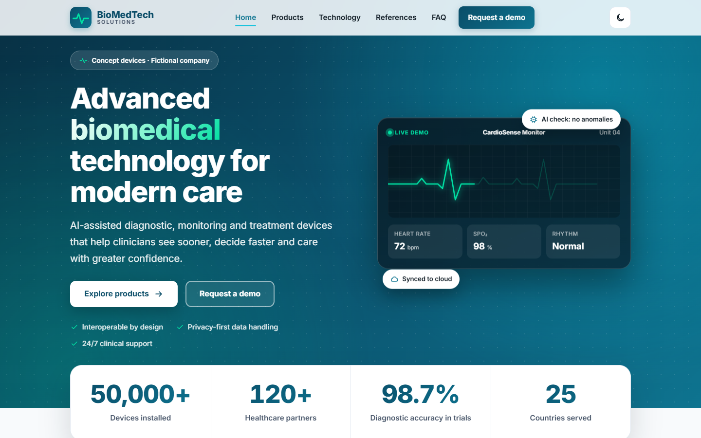
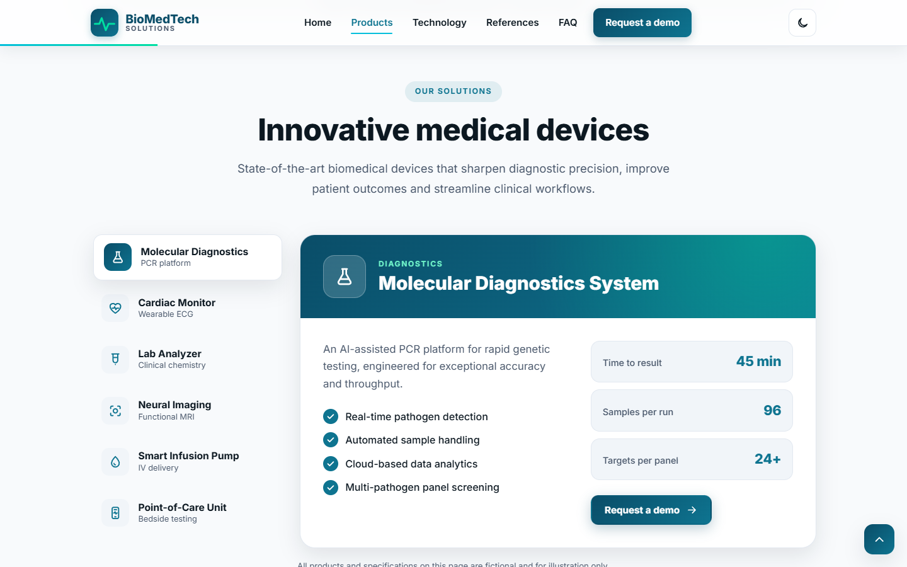
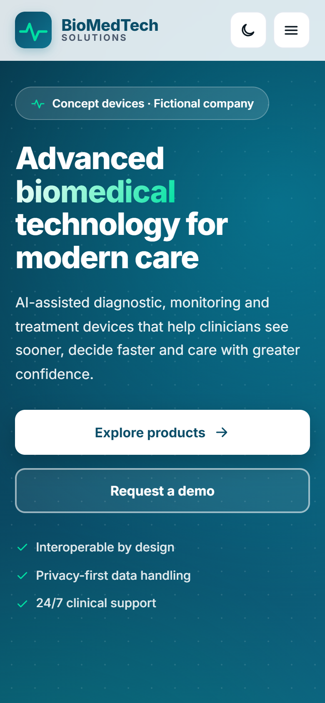

# BioMedTech Solutions - Landing Page

A responsive, multi-section marketing site for **BioMedTech Solutions**, a *fictional* biomedical-technology company. It showcases AI-assisted diagnostic, monitoring and treatment devices, the technology behind them, customer references, an FAQ and a demo-request form. Built with plain HTML, CSS and JavaScript: no framework, no build step.

**[Live demo](https://vaas125.github.io/biomedtech-landing-page/)**



| Product showcase (tabs) | Mobile (390 px) |
| --- | --- |
|  |  |

> **Disclaimer:** BioMedTech Solutions, its products, specifications, statistics, customers and testimonials are all made up for this portfolio project. No real certifications or medical claims are made.

## Features

- **Sticky navigation** with active-section highlighting (scroll position based), smooth scrolling, a scroll-progress bar and a back-to-top button
- **Mobile hamburger menu** with `aria-expanded`, Escape / outside-click to close and focus restoration
- **Scroll-reveal animations** and **animated stat counters** (both disabled when `prefers-reduced-motion` is set)
- **Product showcase** as accessible tabs (ARIA roles, arrow / Home / End keyboard support); each product has a "Request a demo" button that pre-selects the matching option in the form
- **Technology section** with feature highlights and an animated "signal to decision" pipeline
- **Testimonials carousel**: 1 / 2 / 3 slides per view depending on width, dots, previous / next, swipe, arrow keys, autoplay with a pause button (autoplay is off for reduced-motion users)
- **FAQ accordion** with one open item at a time and keyboard navigation
- **"Request a demo" form** with real client-side validation: accessible labels, inline error messages linked through `aria-describedby`, `aria-invalid`, an error summary, focus moved to the first invalid field, a live character counter and a success state
- **Dark / light theme** toggle (follows the system preference, remembered in `localStorage`)
- **Responsive** from 360 px to 1920 px, semantic landmarks, skip link, visible focus styles, Open Graph / Twitter meta tags, inline SVG data-URI favicon, `lang="en"`

### About the form

The demo form **does not send data anywhere**. Validation and the success message run entirely in your browser; no network request is made and nothing is stored. The form says so too.

## Tech stack

HTML5, CSS3 (custom properties, Grid, Flexbox, `clamp()`, keyframe animations), vanilla JavaScript (IntersectionObserver, `requestAnimationFrame`, Pointer Events). The only external request is the optional Google Fonts stylesheet (Inter); the page falls back to system fonts if it cannot load.

## Project structure

```
index.html        Page markup and SVG icon sprite
css/styles.css    Design tokens, layout, components, responsive and reduced-motion rules
js/main.js        Theme, navigation, reveal, counters, tabs, carousel, accordion, form validation
svg/logo.svg      Logo mark
docs/             Screenshots used in this README
```

## Run locally

No build step is required. Open `index.html` in a browser, or serve the folder with any static server:

```bash
npx serve .
```

The site uses only relative paths, so it also works from a sub-path such as GitHub Pages.

## Testing

The interactive behavior was checked in headless Edge with `puppeteer-core`: navigation and active highlighting, mobile menu (open, close via link / Escape / outside tap), tabs with keyboard control, carousel (buttons, dots, wrap-around, keyboard, swipe, per-view breakpoints, autoplay), accordion, form validation (empty submit, per-field errors, success and reset, no network request), theme persistence, no horizontal overflow at 360 - 1920 px, reduced-motion behavior, operation with Google Fonts blocked, and no console errors.

## License

[MIT](LICENSE) © Arif Enes
